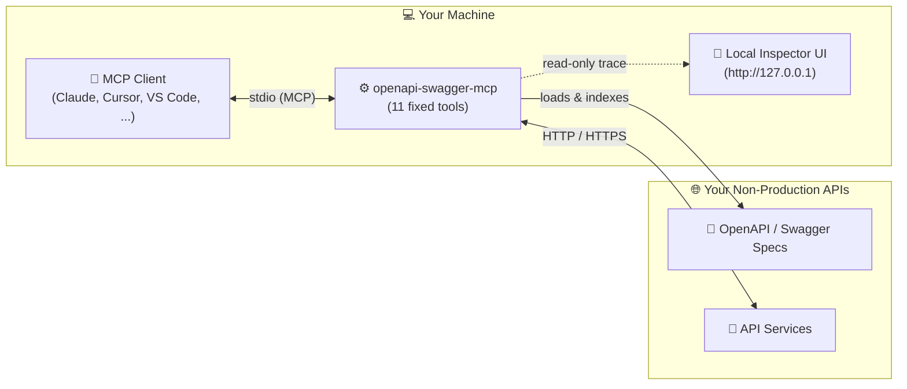
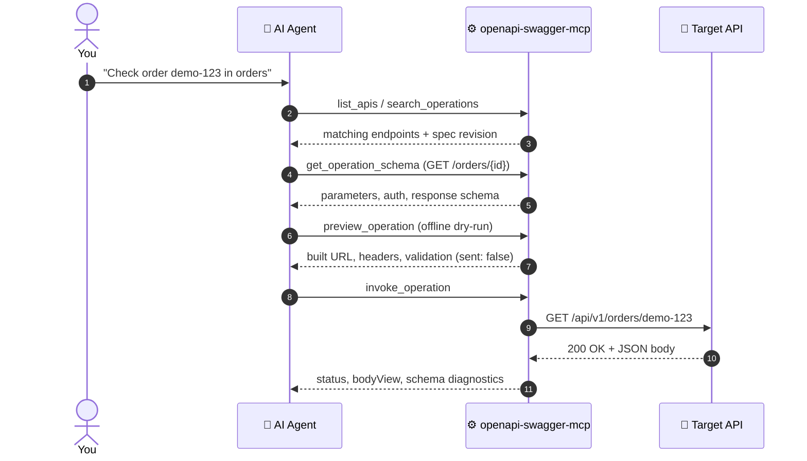

# 🔌 openapi-swagger-mcp

[](https://www.npmjs.com/package/@nhan7777/openapi-swagger-mcp)
[](https://nodejs.org)
[](LICENSE)

Connect your AI coding agent to any **Swagger 2.0** or **OpenAPI 3.0 / 3.1** service from your local machine.

Most OpenAPI-to-MCP bridges generate one tool per endpoint. That works on a 10-route pet store and falls apart on a 400-route backend. `openapi-swagger-mcp` takes a different approach: it gives the agent **11 fixed tools** to search specs, read schemas, dry-run requests, handle auth, and make real HTTP calls, no matter how many endpoints your API has.



---

## 🔎 See what your agent actually sent

Chat summaries only tell you what the model *thinks* happened. When an agent chains five API calls, refreshes a token, and hits a `422`, you want to see the real traffic.

The built-in **Local Request Inspector** opens a read-only web UI on `127.0.0.1` for your active MCP session:

- **🕒 Live activity timeline:** Every MCP tool call is paired with the HTTP requests, redirects, and login/refresh runs it triggered. Offline `preview_operation` checks show up clearly with zero network traffic.
- **🧪 Side-by-side HTTP workbench:** Check full URLs, query parameters, headers, cookies, request bodies, and formatted or hex responses. Secrets injected from your config stay masked by name.
- **📋 Schema checks & cURL export:** Spot request or response fields that broke your OpenAPI contract, and copy a ready-to-run `curl` command for any exchange.

---

## ⚡ Try the built-in demo in 30 seconds

Want to click around the Inspector and test the tools before wiring up your own API? Run `demo` as your MCP server command (requires **Node.js 22.19+**):

```bash
npx -y @nhan7777/openapi-swagger-mcp@0.1.5 demo
```

`demo` spins up a local mock backend on `127.0.0.1` (`demo-shop` and `demo-account`), turns on the Inspector, and serves MCP over `stdio`. Drop that command into your MCP client, then run the `--inspector-url` command printed on `stderr` in a local terminal to watch the agent work in your browser.

---

## 🚀 Quick start

### 1. Create an API config

Run `init` to generate a starter `config.dev.yaml` and a client snippet. It validates your inputs and never touches your editor's config files:

```bash
npx -y @nhan7777/openapi-swagger-mcp@0.1.5 init \
  --service orders \
  --base-url http://localhost:8080/api/v1 \
  --spec http://localhost:8080/v3/api-docs \
  --out config.dev.yaml \
  --client claude-code
```

> 💡 **Tip:** Add `--bearer-env ORDERS_TOKEN` if your API expects a Bearer token. `--client` accepts `generic`, `claude-desktop`, `claude-code`, `cursor`, `vscode`, `windsurf`, `cline`, `codex`, `omp`, or `kiro`.

Prefer writing YAML by hand? Create `config.dev.yaml`:

```yaml
inspector:
  enabled: true
  port: 0

services:
  orders:
    baseUrl: http://localhost:8080/api/v1    # full URL prefix; overrides spec servers/basePath
    spec: http://localhost:8080/v3/api-docs  # URL or relative file path like ./openapi.json
```

### 2. Check the config

```bash
npx -y @nhan7777/openapi-swagger-mcp@0.1.5 --config /absolute/path/config.dev.yaml --check
```

`--check` validates syntax, environment variables, and local file paths offline (`"ok": true`, exit `0`). To also fetch and validate your OpenAPI specs over the network, use `--check-specs`.

### 3. Register the server in your MCP client

Add this `stdio` entry to your MCP client config using the **absolute path** to `config.dev.yaml` (leave `--check` out of `args`):

```json
{
  "mcpServers": {
    "api-dev": {
      "command": "npx",
      "args": [
        "-y",
        "@nhan7777/openapi-swagger-mcp@0.1.5",
        "--config",
        "/absolute/path/config.dev.yaml"
      ]
    }
  }
}
```

Need the exact config file path or CLI command for **Claude Desktop, Claude Code, Cursor, VS Code / GitHub Copilot, Windsurf, Cline, Codex CLI, OMP, or Kiro**? See the [🛠️ MCP Client Setup Guide](docs/clients.md).

### 4. Send a first prompt & open the Inspector

Reconnect the MCP server in your client and start with a safe, read-only prompt:

> List the configured APIs, check whether the `orders` spec loaded, and show `session.sessionId` and `session.inspector.state` without calling any API endpoints.

Next, ask the agent to look up an endpoint and dry-run a request:

> Find the order details endpoint in `orders`, show its required parameters, and preview a request for ID `demo-123` without sending it.

If `inspector.enabled` is `true`, open the browser UI from **your own terminal** using the `sessionId` from `list_apis`:

```bash
npx -y @nhan7777/openapi-swagger-mcp@0.1.5 \
  --config /absolute/path/config.dev.yaml \
  --inspector-url --session <session-id>
```

> 🔒 **Keep the Inspector URL private:** The `#t=...` fragment at the end of the URL is your local access token. Run `--inspector-url` in your own terminal and open it directly in a browser, not inside the AI chat. See the [🔎 Inspector Guide](docs/inspector.md).

---

## 🧭 How a typical session flows



1. **🔍 Discover:** `list_apis` and `search_operations` locate the right endpoint and current spec `revision`.
2. **📐 Read the contract:** `get_operation_schema` returns parameters, request body shape, auth requirements, and response schemas.
3. **🧪 Dry-run:** `preview_operation` builds and validates the request locally (`sent: false`) without touching the network.
4. **🚀 Call:** `invoke_operation` sends the real HTTP request (keeping intentional bad inputs intact for negative testing) and checks the response against the spec.
5. **🔎 Audit:** Open the [Inspector](docs/inspector.md) to review every tool call, HTTP exchange, auth run, and payload.

> ⚠️ **Two rules to keep in mind**
> - **Point at non-production environments** (local, test, or staging). `invoke_operation` sends real `POST`, `PUT`, `PATCH`, and `DELETE` requests with no undo button. Keep your MCP client's tool confirmation prompts enabled.
> - **Know what reaches your LLM provider.** This server runs locally over `stdio` with zero telemetry. However, any tool output your assistant reads is sent by your MCP client to your model provider. Load credentials with `fromEnv` or `fromFile` instead of pasting tokens into chat.

---

## 🧰 The 11 fixed tools

| Group | Tool | What it does |
|---|---|---|
| **🔍 Discovery** | `list_apis` | List configured services, spec readiness, revisions, warnings, and Inspector status |
| | `search_operations` | Search endpoints by path, operationId, text, parameters, or request/response fields |
| | `get_operation_schema` | Read the full contract for one operation (parameters, body, responses, auth) |
| | `refresh_specs` | Reload OpenAPI specs without restarting the server (keeps the last valid snapshot if reload fails) |
| **🚀 Execution** | `preview_operation` | Build and validate a request offline (`sent: false`) with zero network traffic |
| | `invoke_operation` | Send a real HTTP request, return status/body/diagnostics, and optionally capture session auth |
| **🔐 Auth** | `authenticate` | Run a configured login/refresh recipe or reload static credentials |
| | `get_auth_status` | Check credential state, active profile, cookies, and errors without exposing secret values |
| | `manage_session` | Create, inspect, or delete in-memory sessions for OTP, SSO, or imported tokens |
| **📦 Artifacts** | `read_artifact` | Page through or query (via JSON Pointer) large responses and schemas stored on disk |
| | `export_artifact` | Save raw bytes, UTF-8 text, or decoded base64 fields to an allowed local folder |

---

## 📚 Documentation

| Guide | What you will find inside |
|---|---|
| **[🔎 Inspector Guide](docs/inspector.md)** | Turn on the local web UI, open your active session, inspect timelines and HTTP payloads, copy cURL, and fix common issues |
| **[🛠️ MCP Client Setup](docs/clients.md)** | Config file paths, JSON/TOML snippets, and CLI commands for 9 MCP clients |
| **[⚙️ Configuration Guide](docs/configuration.md)** | Multi-service setups, protected specs and `$ref`s, TLS, `network.allow`, operation filters, file roots, and limits |
| **[🔐 Authentication Guide](docs/authentication.md)** | Bearer/Basic/API keys, `fromEnv`/`fromFile` secrets, multi-account profiles, login & 401 refresh recipes, and OTP/SSO sessions |
| **[📖 Usage, Data Boundary & Troubleshooting](docs/reference.md)** | Request body formats, negative testing, reading/exporting large responses, search ranking & aliases, privacy boundary, and error codes |
| **[🧪 Configuration Cookbook](examples/config.example.yaml)** | Copy-ready YAML recipes for every supported setup (validated against [`config.schema.json`](config.schema.json)) |
| **[🧱 Development & Release](docs/development.md)** | Building from source, running tests and the Inspector harness, verifying packages, and publishing |

---

## 📦 Alternative installs & package details

- **Global install:** `npm install -g @nhan7777/openapi-swagger-mcp@0.1.5` (binary: `openapi-swagger-mcp`). Always include the `@nhan7777/` scope; the unscoped `openapi-swagger-mcp` package on npm is a different project.
- **Official MCP Registry:** Published as `io.github.nhan7777/openapi-swagger-mcp` on the [Official MCP Registry](https://registry.modelcontextprotocol.io/v0.1/servers?search=io.github.nhan7777%2Fopenapi-swagger-mcp). Everything runs locally on your machine; never upload private configs or tokens to third-party web hosts.
- **License:** MIT. Third-party notices are in [THIRD_PARTY_NOTICES.md](THIRD_PARTY_NOTICES.md).
