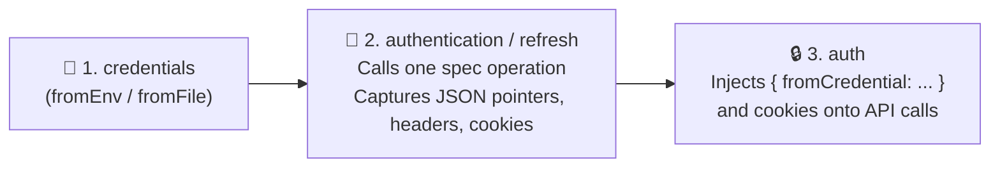

# 🔐 Authentication Guide

Pick the simplest auth setup that works for your target API. Most non-production services only need a static Bearer token or API key.

| Your setup | Jump to |
|---|---|
| 🔑 You already have a Bearer token, Basic credentials, or API key | [1. Static credentials](#1-static-credentials) |
| 🗄️ Your secrets live in environment variables or JSON files | [2. Secret sources](#2-secret-sources) |
| 👥 Several services share one login, or you switch between test roles | [3. Multiple accounts and shared profiles](#3-multiple-accounts-and-shared-profiles) |
| 🔄 You call a login or refresh endpoint to get tokens or cookies | [4. Login and refresh recipes](#4-login-and-refresh-recipes) |
| 📲 Login requires an OTP code, SSO, or a temporary browser token | [5. Interactive sessions (OTP and SSO)](#5-interactive-sessions-otp-and-sso) |

---

## 1. Static credentials

Put an `auth` block directly on a service (or inside a reusable [profile](#3-multiple-accounts-and-shared-profiles)).

### 🎫 Bearer token

```yaml
services:
  orders:
    baseUrl: http://localhost:8080/api/v1
    spec: http://localhost:8080/v3/api-docs
    auth:
      bearer:
        token: { fromEnv: ORDERS_TOKEN }   # raw token without the "Bearer " prefix
```

### 👤 Basic authentication

```yaml
auth:
  basic:
    username: tester
    password: { fromEnv: API_PASSWORD }
```

### 🗝️ API key (header, query, or cookie)

Each entry sets one target (`header`, `query`, or `cookie`). You can combine multiple API keys with Bearer auth and a managed cookie jar:

```yaml
auth:
  bearer: { token: { fromEnv: ACCESS_TOKEN } }
  apiKey:
    - { header: X-CSRF-Token, value: { fromEnv: CSRF_TOKEN } }
    - { query: tenant, value: demo }
  cookies: true
```

- `bearer` and `basic` cannot be used together because both write the `Authorization` header.
- Duplicate header names (case-insensitive) are rejected; query and cookie names are case-sensitive.
- `cookies: true` turns on a managed cookie jar (usually filled by a [login recipe](#4-login-and-refresh-recipes)). To import raw cookies you already have, use an [interactive session](#5-interactive-sessions-otp-and-sso).

---

## 2. Secret sources

Every credential field (`token`, `value`, `username`, `password`, and seed `credentials`) accepts the same source formats:

| Syntax | Where the value comes from |
|---|---|
| `{ fromEnv: API_TOKEN }` | Environment variable of the MCP server process (set in your client entry's `env`) |
| `{ fromFile: ./secrets.json, pointer: /orders/token }` | String field inside a JSON file (RFC 6901 JSON Pointer) |
| `{ fromFile: ./token.json }` | Whole JSON file containing a JSON string like `"my-token"` |
| `{ fromCredential: accessToken }` | Value captured at runtime by a login or refresh recipe |
| `demo-token` | Plain literal string. Allowed for local testing and emits a startup warning (never logs the value) |

- Missing or non-string sources fail loudly instead of silently sending anonymous requests.
- Secret files referenced in your config are automatically blocked from file upload and artifact export. Keep them out of git and restrict their file permissions (`chmod 600`).

---

## 3. Multiple accounts and shared profiles

Define named identities under top-level `profiles` when one service needs multiple test roles (`qa`, `admin`) or several services share one login:

```yaml
profiles:
  qa:
    auth: { bearer: { token: { fromEnv: QA_TOKEN } } }
  admin:
    auth: { bearer: { token: { fromEnv: ADMIN_TOKEN } } }

services:
  orders:
    baseUrl: https://orders.staging.example.test
    spec: ./orders.json
    auth:
      profiles: [qa, admin]
      defaultProfile: qa
  reports:
    baseUrl: https://reports.staging.example.test
    spec: ./reports.json
    auth: { profile: qa }
```

- **Default vs. per-call profile:** `orders` uses `qa` by default. Pass `"auth": { "mode": "profile", "profileId": "admin" }` in `invoke_operation` or `preview_operation` to run a call as `admin`.
- **No `defaultProfile`:** When `profiles` has no `defaultProfile`, calls default to anonymous. The server never guesses a profile on its own.
- **Shared state:** Every service pointing at `qa` shares its captured credentials, cookie jar (still scoped by cookie domain and path), and active refresh task.
- **Auth tool targets:** Pass either `{"service":"orders"}` or `{"profile":"qa"}` (not both) when calling `authenticate` or `get_auth_status`.

---

## 4. Login and refresh recipes

Use `authentication` and `refresh` recipes when an endpoint in your loaded spec trades credentials (username/password, client secret, grant code) for tokens or cookies.



Three blocks work together:
1. **`credentials`:** Initial seed values (never sent unless referenced).
2. **`authentication` / `refresh`:** Calls **one spec operation** and extracts tokens or cookies from the response.
3. **`auth`:** Binds those captured values (`{ fromCredential: ... }` or `cookies: true`) onto outgoing business requests.

```yaml
services:
  accounts:
    baseUrl: https://accounts.staging.example.test
    spec: https://accounts.staging.example.test/v3/api-docs
    auth:
      bearer: { token: { fromCredential: accessToken } }
      apiKey: { header: X-CSRF-Token, value: { fromCredential: csrf } }
      cookies: true
    credentials:
      grantCode: { fromEnv: GRANT_CODE }
    authentication:
      request:
        operation: POST /session/exchange
        body:
          json:
            grantCode: { fromCredential: grantCode }
      capture:
        credentials:
          accessToken: { bodyPointer: /session/accessToken }
          refreshToken: { bodyPointer: /session/refreshToken }
          csrf: { header: X-CSRF-Token }
        cookies: true
    refresh:
      request:
        operation: POST /session/refresh
        body:
          form:
            refresh_token: { fromCredential: refreshToken }
      capture:
        credentials:
          accessToken: { bodyPointer: /access_token }
          refreshToken: { bodyPointer: /refresh_token }
```

### ⚡ How login & refresh work at runtime

1. **Explicit login:** Business calls never trigger a login behind your back. Ask the agent to run `authenticate` with `{"service":"accounts"}`, check `get_auth_status` until state is `ready`, and then call business endpoints.
2. **401 background refresh (no silent replay):** If a business request using managed auth and a `refresh` recipe gets HTTP `401`, the server kicks off a background refresh and returns the original `401` along with `authRecovery`. **It never replays the failed request automatically.** Poll `get_auth_status` until it leaves `recovering`, then decide whether to retry.
3. **Manual refresh:** Call `authenticate` with `{"service":"accounts","action":"refresh"}`.
4. **All-or-nothing capture:** If any declared capture pointer or header is missing from a login/refresh response (HTTP `200..299` by default, or custom `successStatuses`), nothing is updated (`AUTH_CAPTURE_FAILED`).
5. **Recipe request bodies:** Pick one of `body: { json: ... }`, `body: { form: ... }`, `body: { multipart: { fields, files } }`, or `body: { binary: { file, contentType } }`. Recipes inside a named `profile` must set `request.service` explicitly, and `request.auth` defaults to anonymous unless specified.

---

## 5. Interactive sessions (OTP and SSO)

Use an in-memory session when a person and an agent complete a multi-step login together (like requesting an SMS/email OTP code and verifying it) or when importing a short-lived browser token.

### Option A: Capture a session from an API response

1. Call the OTP request endpoint with `auth: { "mode": "anonymous" }`.
2. Once you have the OTP code, call the verify endpoint via `invoke_operation` with a `capture` block:
   ```json
   {
     "service": "accounts",
     "operation": "POST /otp/verify",
     "revision": "<spec-revision>",
     "auth": { "mode": "anonymous" },
     "input": { "body": { "json": { "value": { "code": "<user-supplied-otp>" } } } },
     "capture": {
       "tokens": [{ "id": "access", "type": "bearer", "from": "body", "pointer": "/token" }],
       "cookies": true
     }
   }
   ```
3. When `capture.state` is `"captured"`, pass `"auth": { "mode": "session", "sessionId": "<sessionId>" }` on subsequent `invoke_operation` calls to that service.

### Option B: Import an existing token or cookie (`manage_session`)

To keep tokens out of chat logs, point at an env or file secret declared in top-level `credentialSources`:

```yaml
credentialSources:
  qaSessionToken: { fromEnv: QA_SESSION_TOKEN }
```

Then create the session with `manage_session`:

```json
{
  "action": "create",
  "service": "accounts",
  "credentialSourceIds": [{ "sourceId": "qaSessionToken", "type": "bearer" }]
}
```

*(You can also pass `credentials: { components: [...], cookies: [...] }` directly to `manage_session`, but literal values in tool arguments may be saved in your MCP client's chat transcript.)*

List active sessions with `{"action":"inspect"}` (returns metadata only, never secret values) and remove them with `{"action":"delete","sessionId":"<id>"}`. Sessions belong to a single service, do not auto-refresh, and disappear when the MCP process exits.
