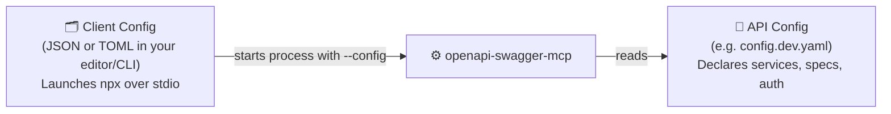

# 🛠️ MCP Client Setup Guide

Step-by-step instructions to connect `openapi-swagger-mcp` to nine MCP clients:

- 🖥️ [Claude Desktop](#claude-desktop)
- ⌨️ [Claude Code](#claude-code)
- ⚡ [Cursor](#cursor)
- 🧩 [VS Code and GitHub Copilot](#vs-code-and-github-copilot)
- 🌊 [Windsurf](#windsurf)
- 🤖 [Cline](#cline)
- 🐚 [Codex CLI](#codex-cli)
- 🥧 [OMP (Oh My Pi)](#omp-oh-my-pi)
- 🦊 [Kiro](#kiro)

---

## 📌 Read this first

### Two separate config files

Keep these two files distinct when setting up the server:



| File | Who reads it | What it contains | Format |
|---|---|---|---|
| **📄 API config** (`config.dev.yaml`) | `openapi-swagger-mcp` | Your API `services` (`baseUrl`, `spec`, `auth`) and optional `inspector`. See [Configuration Guide](configuration.md). | YAML or JSON |
| **🗂️ Client config** (editor / CLI) | Your MCP client | How to launch `openapi-swagger-mcp` over `stdio` (`command`, `args`, optional `env`). | JSON or TOML |

### ✅ Checklist before connecting

1. **Node.js 22.19+** must be on the `PATH` visible to your MCP client (`node --version`).
2. **Validate your API config first** in a terminal:
   ```bash
   npx -y @nhan7777/openapi-swagger-mcp@0.1.5 --config /absolute/path/config.dev.yaml --check
   ```
   Wait for exit code `0` and `"ok": true` (see [Troubleshooting](reference.md#5-validation-and-troubleshooting)).
3. **Always use an absolute path** for `--config`. MCP clients launch `stdio` servers from unpredictable working directories.
4. **Leave `--check` out of your client config.** `--check` prints a validation report and exits right away.
5. **Select `stdio` / `command` transport**, not `HTTP` or `SSE`. The MCP connection runs strictly over `stdin`/`stdout`.
6. **Pin the version** (`@nhan7777/openapi-swagger-mcp@0.1.5`) and keep the `@nhan7777/` scope. The unscoped `openapi-swagger-mcp` package on npm is an unrelated project.

### Shared entry

Most clients use this JSON block under `mcpServers` (VS Code and Codex use slightly different keys, shown in their sections below):

```json
{
  "mcpServers": {
    "api-dev": {
      "command": "npx",
      "args": [
        "-y",
        "@nhan7777/openapi-swagger-mcp@0.1.5",
        "--config",
        "/absolute/path/config.dev.yaml"
      ]
    }
  }
}
```

- If your client's config file already has `"mcpServers"`, add `"api-dev": { ... }` inside it instead of creating a second `"mcpServers"` key.
- If your API config references `{ fromEnv: ORDERS_TOKEN }`, pass `"env": { "ORDERS_TOKEN": "..." }` inside `"api-dev"` (see [Passing secrets via environment variables](configuration.md#passing-secrets-via-environment-variables)).
- On Windows, escape backslashes in JSON strings: `"C:\\Users\\you\\config.dev.yaml"`.

### 🛡️ Keep tool approval prompts enabled

`invoke_operation` sends real `POST`, `PUT`, `PATCH`, and `DELETE` requests with no undo or server-side write lock. Point at non-production targets and **keep your client's confirmation prompts turned on**:

- Keep `autoApprove: []` empty in **Cline** and **Kiro** (never `"*"`).
- Set `default_tools_approval_mode = "prompt"` in **Codex** (never `"approve"`).
- Avoid "always allow" rules for this server's tools, and do not enable VS Code's `sandboxEnabled` on this entry (it auto-approves tool confirmations).

### Safe first prompt

Once connected, verify the setup without calling any business endpoint:

> List the configured APIs and report whether the `orders` spec loaded. If it failed, explain the error without making any API requests.

Replace `orders` with a service ID from your config. Your assistant should call `list_apis` and report the spec revision, operation count, and session ID.

---

## Claude Desktop

🔗 Docs: [Connect to local MCP servers](https://modelcontextprotocol.io/docs/develop/connect-local-servers)

1. From the menu bar, open **Claude > Settings... > Developer > Edit Config** (`~/Library/Application Support/Claude/claude_desktop_config.json` on macOS, `%APPDATA%\Claude\claude_desktop_config.json` on Windows).
2. Add the [shared entry](#shared-entry) under `mcpServers` and save.
3. **Quit Claude Desktop completely and reopen it** so it loads the new config.
4. Click the `+` / connectors icon in the chat input (**Connectors > Manage connectors**) to confirm `api-dev` is connected, then try the [safe first prompt](#safe-first-prompt).
5. **Logs:** `~/Library/Logs/Claude/mcp*.log` (macOS) or `%APPDATA%\Claude\logs` (Windows).

---

## Claude Code

🔗 Docs: [Connect Claude Code to tools via MCP](https://code.claude.com/docs/en/mcp)

Register the server from your terminal (everything after `--` is passed to `npx`):

```bash
claude mcp add --transport stdio api-dev -- npx -y @nhan7777/openapi-swagger-mcp@0.1.5 --config /absolute/path/config.dev.yaml
```

- **Scope:** Defaults to `--scope local` (stored in `~/.claude.json` for the current folder) or pass `--scope user` (available across all projects). Avoid `--scope project` (`.mcp.json`) so you don't commit machine-specific absolute paths to git.
- **With environment variables:** Use `add-json` with the inner server object:
  ```bash
  claude mcp add-json api-dev '{"command":"npx","args":["-y","@nhan7777/openapi-swagger-mcp@0.1.5","--config","/absolute/path/config.dev.yaml"],"env":{"ORDERS_TOKEN":"replace-me"}}'
  ```
- **Manage & verify:** Run `claude mcp list` or `claude mcp get api-dev` in your shell, or run `/mcp` (including **Reconnect**) inside a Claude Code session.

---

## Cursor

🔗 Docs: [Model Context Protocol (MCP) in Cursor](https://cursor.com/docs/mcp)

1. Open `~/.cursor/mcp.json` (global, recommended so absolute paths stay out of git) or `.cursor/mcp.json` (project).
2. Add the [shared entry](#shared-entry) under `mcpServers` (include `"type": "stdio"` if your Cursor version asks for it).
3. Open **Customize** in the Cursor sidebar and make sure the `api-dev` toggle is on.
4. **Logs & restart:** Toggle `api-dev` off and on in **Customize** to restart the server; inspect logs in the Output panel (`Cmd+Shift+U` / `Ctrl+Shift+U` > **MCP Logs**).

---

## VS Code and GitHub Copilot

🔗 Docs: [Add MCP servers in VS Code](https://code.visualstudio.com/docs/agent-customization/mcp-servers), [MCP configuration reference](https://code.visualstudio.com/docs/agents/reference/mcp-configuration)

VS Code supports two config locations with different root keys:

| File | Root key |
|---|---|
| User profile `mcp.json` (**MCP: Open User Configuration**) or `.vscode/mcp.json` | `servers` |
| Portable Copilot `~/.copilot/mcp-config.json` or `.mcp.json` | `mcpServers` |

**Option A (Command Palette):** Run **MCP: Add Server** > **Command (stdio)**, enter `npx -y @nhan7777/openapi-swagger-mcp@0.1.5 --config /absolute/path/config.dev.yaml`, name it `api-dev`, and pick your user/global config.

**Option B (`mcp.json` with `servers` root key):**

```json
{
  "servers": {
    "api-dev": {
      "type": "stdio",
      "command": "npx",
      "args": [
        "-y",
        "@nhan7777/openapi-swagger-mcp@0.1.5",
        "--config",
        "/absolute/path/config.dev.yaml"
      ]
    }
  }
}
```

**Manage & logs:** Run **MCP: List Servers** > select `api-dev` > **Start / Restart / Show Output**.

---

## Windsurf

🔗 Docs: [Cascade MCP Configuration](https://docs.windsurf.com/windsurf/cascade/mcp)

1. In the Cascade panel, click the `...` menu and select **Open MCP config file** (`~/.config/devin/mcp_config.json` on macOS/Linux, `%APPDATA%\devin\mcp_config.json` on Windows, or `~/.codeium/windsurf/mcp_config.json` on older builds).
2. Add the [shared entry](#shared-entry) under `mcpServers` and save.
3. Make sure `api-dev` is enabled under Cascade `...` > **MCPs**, then run the [safe first prompt](#safe-first-prompt).

---

## Cline

🔗 Docs: [MCP in Cline](https://docs.cline.bot/mcp/mcp-overview)

**From the IDE extension:** Click **MCP Servers** in the Cline toolbar > **Configure > Configure MCP Servers**, then add:

```json
{
  "mcpServers": {
    "api-dev": {
      "command": "npx",
      "args": [
        "-y",
        "@nhan7777/openapi-swagger-mcp@0.1.5",
        "--config",
        "/absolute/path/config.dev.yaml"
      ],
      "disabled": false,
      "autoApprove": []
    }
  }
}
```

**From the Cline CLI:**

```bash
cline mcp add api-dev --yes -- npx -y @nhan7777/openapi-swagger-mcp@0.1.5 --config /absolute/path/config.dev.yaml
cline config mcp
```

---

## Codex CLI

🔗 Docs: [Model Context Protocol in Codex](https://learn.chatgpt.com/docs/extend/mcp)

Codex reads `~/.codex/config.toml` (shared by the Codex CLI, IDE extension, and desktop app) under the `mcp_servers` table:

```toml
[mcp_servers.api-dev]
command = "npx"
args = ["-y", "@nhan7777/openapi-swagger-mcp@0.1.5", "--config", "/absolute/path/config.dev.yaml"]
startup_timeout_sec = 60
default_tools_approval_mode = "prompt"
```

- `startup_timeout_sec = 60` gives the initial `npx` package download plenty of time.
- Keep `default_tools_approval_mode = "prompt"` so tool calls ask for confirmation.
- Or add it from the shell with `codex mcp add api-dev -- npx -y @nhan7777/openapi-swagger-mcp@0.1.5 --config /absolute/path/config.dev.yaml`, then add `startup_timeout_sec` and `default_tools_approval_mode` in `config.toml`.
- Verify with `codex mcp list` or `/mcp` inside Codex.

---

## OMP (Oh My Pi)

🔗 Docs: [Oh My Pi](https://github.com/can1357/oh-my-pi) bundled `mcp-config.md`

1. Edit `~/.omp/agent/mcp.json` (user-level config; project-level is `.omp/mcp.json`):
   ```json
   {
     "mcpServers": {
       "api-dev": {
         "type": "stdio",
         "command": "npx",
         "args": [
           "-y",
           "@nhan7777/openapi-swagger-mcp@0.1.5",
           "--config",
           "/absolute/path/config.dev.yaml"
         ]
       }
     }
   }
   ```
2. Inside OMP, run `/mcp reload`, `/mcp list`, or `/mcp test api-dev` (and `/mcp reconnect api-dev` after config edits). Tools appear as `mcp__api_dev_<tool>`.

---

## Kiro

🔗 Docs: [MCP configuration in Kiro](https://kiro.dev/docs/mcp/configuration/)

1. Open your user MCP config (`~/.kiro/settings/mcp.json`, or run **Kiro: Open user MCP config (JSON)** from the Command Palette) and confirm MCP support is enabled in Settings.
2. Add the server entry with an empty `autoApprove` array:
   ```json
   {
     "mcpServers": {
       "api-dev": {
         "command": "npx",
         "args": [
           "-y",
           "@nhan7777/openapi-swagger-mcp@0.1.5",
           "--config",
           "/absolute/path/config.dev.yaml"
         ],
         "disabled": false,
         "autoApprove": []
       }
     }
   }
   ```
3. Save the file. Kiro reloads updated servers automatically. Check status in the Kiro MCP panel or with `/mcp` in Kiro CLI.
