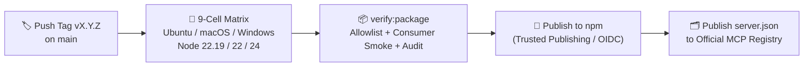

# 🧱 Development & Release Guide

This guide is for contributors and maintainers working from a source checkout of `openapi-swagger-mcp`.

---

## 🛠️ Local build & verification

Requires **Node.js 22.19+** and npm:

```bash
npm ci
npm run gen:assets      # embed Inspector UI assets into src/inspector/assets.ts
npm run build           # compile TypeScript to dist/
npm run typecheck       # check both src and tests tsconfigs
npm run gen:schema      # regenerate config.schema.json from src/config-schema.ts
npm test                # run full Vitest unit + integration suite
npm run smoke           # end-to-end stdio CLI smoke test
npm run verify:package  # pack tarball, install into clean consumer dir, smoke-test & audit
npm audit --omit=dev --audit-level=high
```

- **Build order:** Run `npm run build` before `npm test`, `npm run smoke`, or `npm run verify:package`, because integration and smoke tests spawn the compiled `dist/cli.js` over `stdio`.
- **Generated files in CI:** CI fails if `npm run gen:schema` (`config.schema.json`) or `npm run gen:assets` (`src/inspector/assets.ts`) leaves uncommitted changes. Run `npm run gen:notices` whenever dependencies change to update `THIRD_PARTY_NOTICES.md`.
- **Search benchmark:** `npm run bench:search` runs the lexical retrieval benchmark in `bench/search` (see `bench/search/README.md`).

---

## 🔎 Inspector smoke & live verification harness

After editing anything under `src/inspector/`, rebuild the embedded assets and TypeScript output, then run the Inspector smoke suite:

```bash
npm run gen:assets && npm run build
node tests/inspector-smoke.mjs
```

To test the UI interactively in a browser against a live synthetic backend and compiled CLI, hold the harness open:

```bash
node tests/inspector-smoke.mjs --hold
```

The harness prints only the session descriptor path (never the secret token URL). While held, send newline-delimited JSON commands on `stdin` to drive deterministic MCP traffic and in-flight requests:

```jsonl
{"id":"seed","action":"seed","count":230}
{"id":"one","action":"invoke","operation":"GET /widgets/{id}","input":{"path":{"id":7}}}
{"id":"slow","action":"start","operation":"GET /widgets/{id}","input":{"path":{"id":7},"query":{"hold":"1"}}}
{"id":"release","action":"release"}
{"action":"stop"}
```

---

## 📦 Package verification & release process



### `npm run verify:package`

`verify:package` packs the real tarball (`npm pack`), checks the exact file allowlist (`scripts/verify-package.mjs`), installs the tarball into an isolated consumer folder (with spaces in paths), runs `--check`, the binary shim, and the `stdio` smoke test against the installed copy, and runs `npm audit`.

- Passing builds write `.release/<name>.tgz` and `.release/<name>.tgz.sha256`.
- Failed audits save diagnostic reports under `.release/diagnostic/NOT-RELEASABLE-...`.

### 🚀 Tagged releases & Official MCP Registry

1. Pushing a version tag (`vX.Y.Z` matching `package.json` and `server.json` on `main`) triggers the 9-cell OS/Node matrix (Ubuntu, macOS, Windows across Node `22.19.0`, `22`, and `24`).
2. Once all matrix cells pass, the publish workflow builds and verifies the tarball, publishes to npm via trusted publishing, polls npm metadata until live, and publishes `server.json` to the [Official MCP Registry](https://registry.modelcontextprotocol.io/v0.1/servers?search=io.github.nhan7777%2Fopenapi-swagger-mcp) via `mcp-publisher` + GitHub OIDC.
3. **Registry-only recovery:** If npm publication succeeds and only the MCP Registry step fails afterward, **do not** delete the git tag or bump/re-publish npm. Recover only the registry step from the repo root:
   ```bash
   mcp-publisher validate
   mcp-publisher login github
   mcp-publisher publish
   ```
   Never commit `.mcpregistry_*` files.
