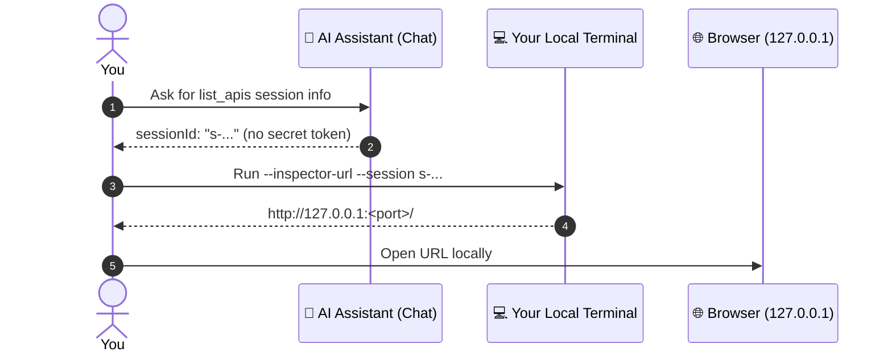

# 🔎 Local Request Inspector Guide

When an AI agent searches your spec, logs in, and calls endpoints, chat messages only show what the model decided to summarize. The **Local Request Inspector** opens a read-only web UI on `127.0.0.1` so you can see what your MCP server process actually ran.

- **🕒 Confirm what went over the wire:** Every MCP tool call is grouped with the HTTP requests, redirects, and background login/refresh runs it triggered. Offline `preview_operation` dry-runs show up as tool calls with zero HTTP traffic.
- **🧪 Inspect real payloads and responses:** View URLs, query parameters, headers, cookies, request bodies, and responses side-by-side in formatted, plain-text, or raw hex tabs.
- **🚨 Jump straight to failures:** Filter down to blocked calls, `4xx`/`5xx` responses, or schema validation warnings without scrolling through chat history.
- **📋 Copy payloads or cURL safely:** Copy URLs, full bodies, or generated `curl` commands while secrets from your config stay masked as placeholders.

The MCP connection itself still runs over `stdio`. When enabled, the Inspector starts a local HTTP server bound strictly to loopback (`127.0.0.1` or `::1`). It is purely read-only: it never sends API requests or runs copied `curl` commands.

---

## ⚙️ 1. Enable the Inspector

Add the top-level `inspector` block to your API config file:

```yaml
inspector:
  enabled: true
  port: 0

services:
  orders:
    baseUrl: http://localhost:8080/api/v1
    spec: http://localhost:8080/v3/api-docs
```

- The Inspector is off by default (`enabled: false`).
- `port: 0` grabs a free loopback port for each MCP process so multiple agent windows never conflict.
- Reconnect or restart the MCP server in your client after editing the config.
- **Session cleanup:** Normal MCP shutdown deletes the session's trace and artifacts (and stops its Inspector UI). To keep session files on disk after exit, set `files.retention.keepOnExit: true` (see [File roots and session retention](configuration.md#file-roots-and-session-retention)).

---

## 🔑 2. Open the URL for your active session

Several MCP clients or editor windows can share the same config file at the same time. Each process gets its own session ID (`s-...`) and its own Inspector port.



### Step A: Get the session ID from your assistant

Ask the assistant in the window you want to inspect:

> Call `list_apis` and show `session.sessionId`, `session.inspector.state`, and `session.inspector.urlCommand`. Do not run the command.

*(That same token-free session metadata is also included in MCP initialization instructions and printed to `stderr` at startup.)*

### Step B: Resolve the browser URL in your own terminal

When `session.inspector.state` is `running`, run `urlCommand` (or pass `--inspector-url --session <id>`) in **your own local terminal**:

```bash
npx -y @nhan7777/openapi-swagger-mcp@0.1.5 \
  --config /absolute/path/config.dev.yaml \
  --inspector-url --session <session-id>
```

Open the printed URL in a local browser (or through an explicit SSH port forward).

- **🔒 Keep the URL out of chat, logs, and screenshots.** The `#t=...` fragment carries the session's access token (read from the mode-`0600` `inspector.json` file). Never ask the AI agent to run `--inspector-url` for you.
- `--inspector-url` only looks up a running Inspector; it never starts a server or modifies session files.
- Leaving `--session` off prints URLs for **all** live Inspectors using that config. If you have multiple agent windows open, always pass `--session <session-id>` so you open the right timeline. An unknown or stopped session exits `1` with `INSPECTOR_NOT_RUNNING` instead of guessing another session.

---

## 🧭 3. Reviewing an agent run

1. **🕒 Follow the live timeline**
   - As the agent works, tool calls stream in with their child HTTP requests, redirect hops, and auth runs nested underneath.
   - Click **Pause** to freeze updates while inspecting a busy run, and **Resume** to catch up. Switch themes with **Auto / Light / Dark**.
2. **🔍 Filter across session history**
   - Use the quick tabs: **All Activity**, **Tools Only**, **API Requests Only**, and **Errors & Blocked**.
   - Filter by service, purpose, send state (`not_sent`, `maybe_sent`, `response_received`), or HTTP status. Filters search across the full retained session history on disk, not just the visible page. Click **Load older records** to page back further.
3. **🔀 Compare tool calls and HTTP exchanges**
   - Click a **tool row** to view recorded tool arguments, status summary, and linked exchanges (with **Copy Target**, **Copy Args**, and **Copy Summary** buttons).
   - Click an **HTTP row** to open the side-by-side **Request + Response** workbench with status, timing, headers, query parameters, cookies, and body pages.
4. **📄 Switch body views**
   - Toggle between **Formatted (derived)**, **Text (derived)**, and **Raw (hex)** (exact stored bytes).
   - Watch for inline banners when a payload was cut off by byte limits or pretty-printed for display.
5. **📋 Copy payloads or cURL**
   - **Copy URL**, **Copy Path**, and **Copy Domain** (`scheme://host:port`) copy target URLs while keeping masked query secrets as placeholders.
   - **Copy Request Body** and **Copy Response Body** copy the complete stored payload across pages without UI annotations (check any incomplete-body banner first).
   - Open the **cURL** tab and click **Copy cURL**. Always check the credential placeholders and target URL before running the command in your shell.

### 🛡️ What stays masked or omitted

- **Configured secrets stay hidden:** Credentials injected from `auth` blocks, profiles, sessions, or the cookie jar are recorded by binding name only, never by secret value.
- **Auth recipe requests:** Request bodies built from login/refresh secret templates and auth response header values are omitted from the trace. Raw auth response bodies are saved locally (mode `0600`) so you can debug login failures, so treat session files with care.
- **Agent-typed values:** If you or the agent type a raw token directly into normal tool `input` fields, it is recorded like any other user input. Avoid pasting real secrets into chat.

---

## 🩺 4. Troubleshooting

| Symptom | Cause & fix |
|---|---|
| `INSPECTOR_DISABLED` / state `disabled` | Add `inspector: { enabled: true, port: 0 }` to the config file used by your MCP client, then reconnect the server. |
| `INSPECTOR_NOT_RUNNING` | The MCP server has not started, has already exited, or `--session` points to an ended/different config. Reconnect and grab the current `sessionId` from `list_apis`. |
| State `unavailable` | The loopback port could not bind (for example, a fixed port was already taken). Check `stderr` logs and switch to `port: 0`. MCP tools continue working even if the Inspector fails to bind. |
| Empty timeline or wrong agent activity | Compare the session ID in the top bar of the Inspector with `session.sessionId` from `list_apis` in your chat window, and clear any active timeline filters. Also check that `trace.enabled` is not `false`. |
| Missing body or masked header/cookie | Check the availability banner on the exchange. Server-injected credentials, bodies over `requestBodyTraceBytes` / `responseBytes`, and login request templates are intentionally omitted. |
| Old UI after upgrading the package | Refreshing the browser tab still connects to the old running MCP process. Reconnect the MCP server in your client and open the new session's URL. |
