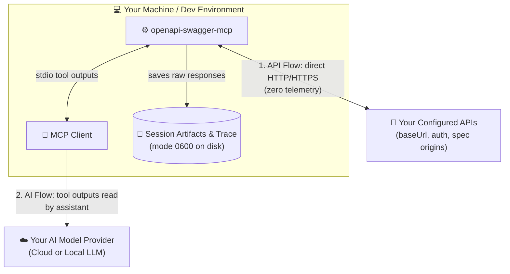

# 📖 Usage, Data Boundary & Troubleshooting

This guide explains where your data goes, how request payloads and negative testing work, how to read or export large responses, how operation search ranks endpoints, and how to fix common errors.

---

## 🔒 1. Local execution & data privacy boundary

`openapi-swagger-mcp` runs on your machine as a `stdio` child process of your MCP client. If your client runs inside a container or remote dev box, HTTP requests come from that environment.

There are two separate data flows:



| Flow | What travels where |
|---|---|
| **🌐 API flow** | The server sends HTTP requests straight to your configured `baseUrl` origins, login/refresh endpoints, and spec/`$ref` sources. There is **no author backend, no telemetry, and no external search/embedding call**. Raw responses are saved in a local per-session folder (`files.artifactRoot`). |
| **🤖 AI flow** | Tool outputs read by your assistant go back to your MCP client. If your client uses a cloud LLM, **anything the assistant reads (including via `read_artifact`) can be sent to that model provider**. Raw API responses are not scrubbed of tokens or personal data. |

### 🗂️ Execution trace & artifacts

- **Artifacts** store raw HTTP response bodies, large OpenAPI schemas, and oversized tool inputs in a mode-protected per-session folder. By default, normal process exit removes the session directory (configure via `files.retention` in the [Configuration Guide](configuration.md#file-roots-and-session-retention)).
- **Execution trace** records `callId`, `requestId` (one per HTTP hop, auth call, or spec fetch), and `authRunId`, along with timing and send state (`not_sent`, `maybe_sent`, `response_received`). Configured secrets injected by the server are logged by binding name only (`unrecordedReason: credential`). Browse live session traces in the [🔎 Local Request Inspector](inspector.md).

---

## 🧪 2. Calling tools: preview, payloads & negative testing

### Standard tool sequence

Your AI assistant builds JSON tool arguments automatically from natural-language prompts:

| Step | Tool | Example arguments |
|---|---|---|
| 1. Check loaded APIs | `list_apis` | `{}` |
| 2. Search endpoints | `search_operations` | `{"service":"orders","query":"order detail","limit":5}` |
| 3. Read contract | `get_operation_schema` | `{"service":"orders","operation":"GET /orders/{id}","revision":"<rev>"}` |
| 4. Dry-run or call | `preview_operation` / `invoke_operation` | `{"service":"orders","operation":"GET /orders/{id}","revision":"<rev>","input":{"path":{"id":"demo-123"}}}` |

- **`operation` key:** Always pass the key returned by search (such as `GET /orders/{id}`), not `operationId`.
- **`revision` guard:** Stops the agent from calling an endpoint against a stale spec snapshot (`SPEC_REVISION_MISMATCH`). After running `refresh_specs`, grab the new `revision` from `list_apis`, `search_operations`, or `get_operation_schema`.

### `preview_operation` vs. `invoke_operation`

`preview_operation` runs the exact same request serializer and policy checks as `invoke_operation`, without touching the network transport:

- Returns `sent: false`, `ready`, `blockers`, target URL, method, headers, query pairs, cookies, bounded body, and request schema diagnostics.
- Configured credentials show up by binding name only; values typed directly in `input` show up as typed.
- Preview is **not** an approval gate, and only models the initial request (redirects, 401 refreshes, `Set-Cookie` updates, DNS/TLS checks, and transport headers like `content-length` happen only on `invoke_operation`).

### 📨 Request body formats (`invoke_operation.input`)

Pass at most one body format inside `input.body` (note the `json.value` and `form.fields` wrappers here, which differ from YAML auth recipes):

```json
// JSON
{ "body": { "json": { "value": { "name": "demo", "quantity": 2 } } } }

// Form URL-encoded (application/x-www-form-urlencoded)
{ "body": { "form": { "fields": { "name": "demo", "tags": ["a", "b"] } } } }

// Multipart upload (file paths must be absolute and inside files.uploadRoots)
{
  "body": {
    "multipart": {
      "fields": { "description": "demo" },
      "files": [{ "field": "document", "path": "/abs/path/fixtures/demo.pdf", "contentType": "application/pdf" }]
    }
  }
}

// Binary upload (file path inside files.uploadRoots)
{ "body": { "binary": { "file": "/abs/path/fixtures/demo.bin", "contentType": "application/octet-stream" } } }
```

### 🎯 Per-call auth modes & negative testing

- **Auth selection (`auth`):** Pick `{"mode":"default"}` (or omit), `{"mode":"profile","profileId":"qa"}`, `{"mode":"session","sessionId":"<id>"}`, or `{"mode":"anonymous"}`. Passing an explicit `input.headers.Authorization` overrides managed auth for that single call without triggering a 401 refresh, which is handy when testing invalid or expired tokens.
- **Intentional invalid inputs:** Payloads are serialized **as-is**: no defaults injected, no type coercion, and no stripping of `null` or extra fields.
- **HTTP outcomes vs. diagnostics:** HTTP `4xx`/`5xx` responses come back as normal tool results (`http.status`, `bodyView`), paired with advisory `diagnostics.request` and `diagnostics.response` (`valid`, `invalid`, `not_available`, `error`). Only unsafe transport inputs (missing path params, path traversal, CR/LF header injection, undeclared media types) are blocked locally (`sent: false`).
- **Network failures & redirects:** Timeouts or TLS resets set `error.mayHaveBeenSent` instead of faking an HTTP status, so check before retrying non-idempotent writes. Redirects are off by default; `followRedirects: true` follows only same-origin redirects under the service's `baseUrl` path prefix and never forwards credentials cross-origin.

---

## 📦 3. Large responses & file exports (Artifacts)

To prevent multi-megabyte JSON payloads, binary downloads, and base64 blobs from flooding chat context, responses are saved on disk as artifacts (`rawBodyArtifact`) and trimmed in `bodyView` (`bodyTransformed: true`, with details in `omissions`).

### Read slices with `read_artifact`

Extract a specific JSON Pointer or page through text/JSON with `nextOffset`:

```json
{ "artifactId": "<id>", "pointer": "/data/items/0" }
```
```json
{ "artifactId": "<id>", "offset": 0, "limit": 4096 }
```

*(Binary artifacts return metadata only; export them to disk to use the file.)*

### Save files with `export_artifact`

First declare `files.exportRoots` in your config, then export to a **new** file path inside an allowed folder (existing files are never overwritten):

```json
{
  "artifactId": "<id>",
  "pointer": "/data/imageBase64",
  "destination": "/absolute/path/exports/image.png",
  "representation": "decoded"
}
```

`representation` accepts `"original"` (exact bytes), `"text"` (UTF-8 text at root or pointer), or `"decoded"` (strict base64 decode). You can also pre-declare known base64 JSON paths in your config under `encodedFields` (`service`, `pointer` with `*` segment wildcards, `encoding: base64`, `mediaType`).

---

## 🔍 4. How `search_operations` works

Search runs locally in memory over your loaded specs using lexical ranking (no external LLM or embedding calls):

- **Indexed fields:** `METHOD /path`, `operationId`, tags, summary, description, parameter names/descriptions, nested request and response field paths (tracked separately), schema names, and response headers.
- **Text normalization:** Splits `camelCase`, `snake_case`, and `kebab-case`; folds Latin accents (`don hang` matches `đơn hàng`); preserves CJK, Kana, and Southeast Asian script distinctions; and applies bounded typo tolerance when exact tokens do not match.
- **Field-scoped queries:** Narrow matches via `fields` (`identifier`, `text`, `parameter`, `requestField`, `responseField`, `schema`). For example, `{"query":"taxCode","fields":["responseField"]}` finds endpoints that *return* `taxCode`.
- **Custom business synonyms (`search.aliases`):** Lexical search does not guess domain synonyms on its own. Add business terms or bilingual aliases in your config:
  ```yaml
  search:
    aliases:
      - { terms: ["đơn hàng", "order"], services: [orders] }
  ```

---

## 5. Validation and troubleshooting

### Static check vs. network spec check

| Command | Network calls | What it verifies |
|---|---|---|
| `--config <file> --check` | None | Parses YAML/JSON against the schema, checks referenced env vars, JSON secret files/pointers, local spec/CA files, and upload/export roots. Exit `0` = ok, `1` = config/source error, `2` = CLI usage error. |
| `--config <file> --check-specs` | Spec & `$ref` URLs only | Loads every service's spec through the server's network policy and `spec.auth`, printing `ready`/`unavailable` state, `revision`, and `operationCount`. Never logs in or calls business endpoints. |

### 🩺 Common error codes

| Code / symptom | How to resolve |
|---|---|
| Client fails to connect on startup | Confirm Node.js >= 22.19, check that `--config` uses an absolute path, and make sure `--check` is **not** in the client's `args`. |
| `CONFIG_INVALID` | Run `--check` to find the bad field; validate against `config.schema.json`. |
| `SOURCE_UNAVAILABLE` / `CREDENTIAL_INVALID` | Check that the env var is set in the MCP client entry's `env` (not just your shell) or that the JSON file pointer resolves to a string. |
| Service state `unavailable` | Check the error in `list_apis` (or run `--check-specs`). Fix the spec URL/file, `$ref` target, `network.allow`, or CA cert, then call `refresh_specs`. |
| `SPEC_REVISION_MISMATCH` | The spec reloaded after you read it. Call `list_apis`, `search_operations`, or `get_operation_schema` to get the current `revision`. |
| `OPERATION_NOT_ALLOWED` | Blocked by `services.<id>.operations` (`include`/`exclude` filter). |
| `AUTH_REQUIRED` / `AUTH_TARGET_REQUIRED` | Check static secret sources, run `authenticate` first, create an OTP session, or pass a `profile` when a multi-profile service has no `defaultProfile`. |
| `AUTH_RECOVERING` / `AUTH_BUSY` | Poll `get_auth_status` until the active login/refresh finishes before sending new calls or switching auth actions. |
| `AUTH_REFRESH_UNAVAILABLE` | No `refresh` recipe is configured; re-run `authenticate` or update your session. |
| `AUTH_RECIPE_INPUT` / `AUTH_RECIPE_FAILED` / `AUTH_CAPTURE_FAILED` | Check seed `credentials`, recipe operation/status (`successStatuses`), and response JSON Pointers, headers, or cookies. |
| `UPLOAD_NOT_ALLOWED` / export failure | Check `files.uploadRoots` / `files.exportRoots`, make sure symlinks stay inside the root, and pass a new destination file path on export. |
